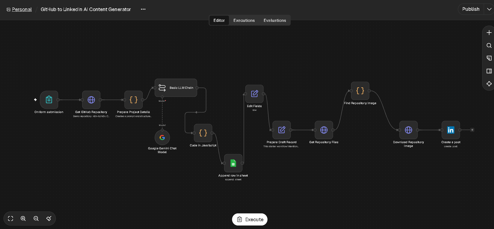
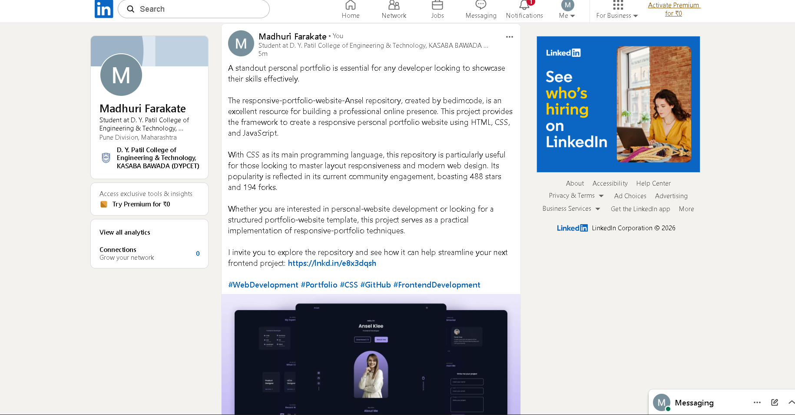

# RepoPost--Ai

# 🚀 RepoPost AI
### Automated GitHub Repository Image Discovery and LinkedIn Content Publishing Using Generative AI

RepoPost AI is an n8n-based automation project that retrieves GitHub repository information, generates promotional content using Google Gemini AI, discovers and downloads repository images, stores project details in Google Sheets, and publishes project posts on LinkedIn.

## 📌 Project Overview

Developers often spend time manually writing project descriptions and sharing their work on professional platforms. RepoPost AI automates these repetitive tasks using workflow automation and generative AI.

The workflow connects GitHub, Google Gemini, Google Sheets, and LinkedIn to simplify project promotion.

## ✨ Features

- 🔗 Retrieve GitHub repository information.
- 🤖 Generate project descriptions using Google Gemini AI.
- 🖼️ Find and download images from repository files.
- 📊 Save project details in Google Sheets.
- 💼 Prepare and publish project content on LinkedIn.
- ⚙️ Automate multiple tasks using n8n.
- 🔍 Track workflow execution and identify errors.

## 🛠️ Technologies Used

- **n8n** — Workflow automation
- **GitHub API** — Repository information and file retrieval
- **Google Gemini AI** — AI-powered content generation
- **Google Sheets** — Project record storage
- **LinkedIn API** — Professional content publishing
- **JavaScript** — Data processing and formatting

## 🔄 Workflow

1. Submit project details through the input form.
2. Retrieve repository information from GitHub.
3. Prepare project details for AI processing.
4. Generate promotional content using Google Gemini.
5. Format and process the generated content.
6. Save project details in Google Sheets.
7. Retrieve repository files and identify an image.
8. Download the selected repository image.
9. Create a LinkedIn post with the generated content and image.

## 🏗️ System Architecture

User Input
    |
    v
GitHub Repository Retrieval
    |
    v
Prepare Project Details
    |
    v
Google Gemini AI
    |
    v
JavaScript Data Processing
    |
    v
Google Sheets Record
    |
    v
Find and Download Repository Image
    |
    v
Create LinkedIn Post

## 📸 Screenshots

### Complete n8n Workflow

### LinkedIn Post Output

> Replace these image paths with the actual locations and filenames of your uploaded screenshots.

## 🎥 Project Demo Video

Watch the demonstration of RepoPost AI:
"https://github.com/madhurifarakate399/RepoPost--Ai/blob/main/Video.mp4"

Replace the placeholder with your YouTube video URL or another accessible video link.

## 📂 Project Files

- `RepoPost-AI-Workflow.json` — Exported n8n workflow
- `README.md` — Project documentation
- `screenshots/` — Workflow and output screenshots
- `report/RepoPost-AI-Project-Report.pdf` — Project report

## ⚙️ Setup and Usage

1. Download or clone this repository.
2. Open your n8n workspace.
3. Import `RepoPost-AI-Workflow.json`.
4. Configure your own GitHub, Google Gemini, Google Sheets, and LinkedIn credentials.
5. Verify the workflow node configurations and permissions.
6. Test the workflow using a GitHub repository that contains a suitable image.
7. Confirm that the generated content, image, and Google Sheets record are correct before publishing.

## 🔐 Security

- Never upload API keys, passwords, or access tokens.
- Store credentials securely in n8n.
- Review generated content before publishing.
- Use only images you have permission to share.
- Keep personal and confidential information out of public repositories.

## 🚀 Future Enhancements

- Schedule posts automatically.
- Support multiple GitHub repositories.
- Improve image selection.
- Add human approval before publication.
- Support multiple social media platforms.
- Add better error handling and publishing analytics.

## 👨‍💻 Author

**Name:** Madhuri Farakate 
**Project:** RepoPost AI  
**Domain:** Workflow Automation and Generative AI

## 📚 References

- [n8n Documentation](https://docs.n8n.io/)
- [GitHub REST API](https://docs.github.com/en/rest)
- [Google Gemini API](https://ai.google.dev/gemini-api/docs)
- [Google Sheets API](https://developers.google.com/sheets/api)
- [LinkedIn API Documentation](https://learn.microsoft.com/en-us/linkedin/)

---

⭐ If you find this project useful, feel free to explore the workflow and learn more about AI-powered automation.
